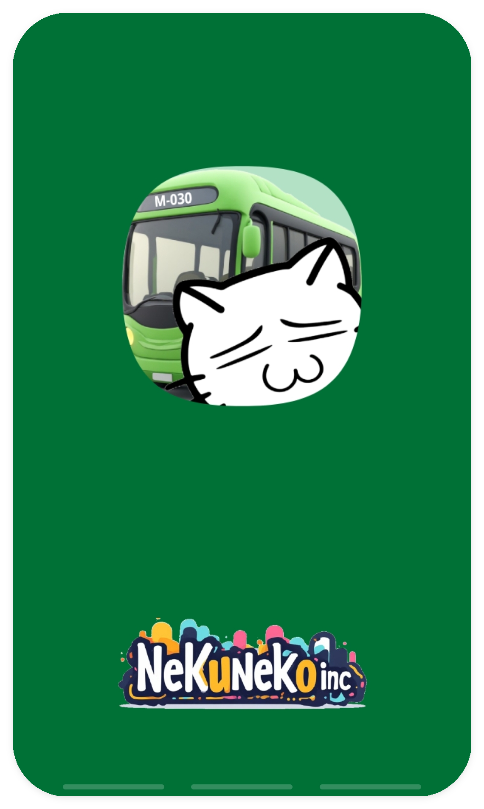
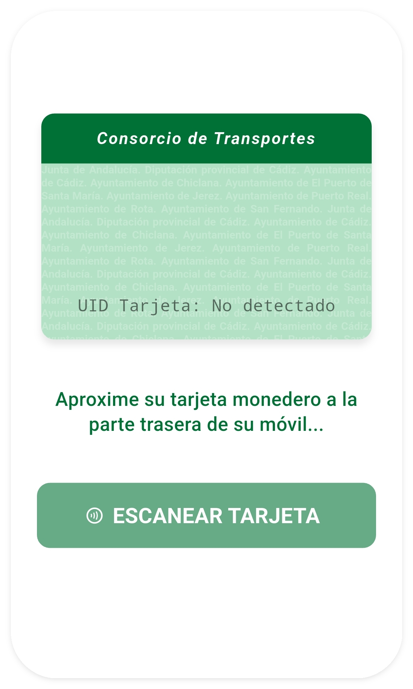
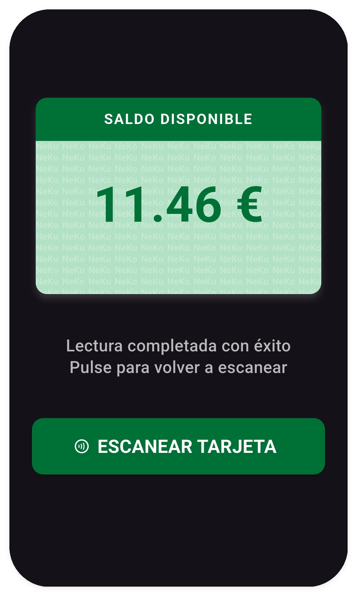

<p align="center">
    
    <br>
    <b style="font-size: 2em;">Saldo Andalucía</b>
</p>


## Descripción

Este proyecto ha sido concebido de forma **estrictamente conceptual** como una demostración de ingeniería de software, arquitectura limpia en entornos móviles y criptografía aplicada, sirviendo como pieza de desarrollo avanzado para portafolio profesional. 

La aplicación realiza una lectura de datos a través de librerías nativas en tarjetas inteligentes de transporte intermodal basadas en tecnología **MIFARE Classic**.

## Motivación

La creación de esta app nace al detectar una oportunidad de mejora en la experiencia de usuario del transporte público andaluz:
1. **La centralización del servicio:** La aplicación oficial ***Consorcio de Málaga*** permite leer el saldo de las tarjetas de cualquier provincia andaluza gracias a la interoperatibilidad de la red. Sin embargo, esto no suele ser conocido por los usuarios de otras provincias. 

2. **Proteger al usuario de software publicitario:** La aplicación oficial de la red de consorcios provinciales carece de esta funcionalidad de consulta de saldo de la tarjeta monedero por NFC. Ante la necesidad de los propios usuarios, han proliferado en la *Google Play Store* varias de aplicaciones de terceros repletas de publicidad o de dudosa procedencia que se lucran con una tarea que debería ser directa, limpia y transparente para el ciudadano.

3. **Mejora futura (Ecosistema de Recarga):** Esta aplicación podría usarse de apoyo para que el usuario pudiera acceder a la pasarela de pago correspondiente y recargar la tarjeta desde su propio móvil de forma intutiva y sencilla sin tener que acudir a ningún punto de venta.

Este proyecto se ha desarrollado con fines estrictamente educativos y demostrativos para probar que es posible disponer de una interfaz moderna, fluida y segura, ofreciendo a los usuarios una alternativa de código abierto y sin anuncios comerciales.

## Capturas de Pantalla

A continuación se muestra el diseño de la interfaz de la aplicación, compatible con el modo oscuro, utiliza una estética limpia con colores inspirados en la red intermodal y un fondo dinámico que recrea el patrón de filigranas de las tarjetas físicas:
<p align="center">
  
  
  
</p>

## Nota sobre funcionamiento en Android
Por motivos estrictos de seguridad y cumplimiento legal, este repositorio **no contiene ni distribuye ninguna clave criptográfica privada**. 

Para que la aplicación pueda leer el saldo, necesita realizar el proceso de autenticación en el **sector 9** de la tarjeta de transportes, el desarrollador debe suministrar su propia llave de acceso autorizada en el momento de la compilación utilizando variables de entorno de Dart. Ver más abajo.

## Limitaciones de funcionamiento en iOS
Lamentablemente, aunque la base del código es multiplataforma, esta aplicación **no es compatible con iOS**. 

Esto se debe a una limitación física de hardware: los chips NFC integrados por Apple en los dispositivos iPhone no cuentan con soporte de silicio ni coprocesamiento para el algoritmo propietario `Crypto1` (requerido para la comunicación con el estándar industrial MIFARE Classic). Apple restringe la interacción NFC en estos sistemas debido a la obsolescencia de seguridad de dicho algoritmo a nivel global.


## Instrucciones de Compilación y Despliegue

### Configuración de Permisos (Android)

Para asegurar el correcto acceso al hardware de radiofrecuencia, verifica que tu archivo `android/app/src/main/AndroidManifest.xml` incluya las siguientes directivas. Deben posicionarse dentro de la etiqueta `<manifest>` y estrictamente antes de la apertura de la etiqueta `<application>`:

```xml
<uses-permission android:name="android.permission.NFC" />
<uses-feature android:name="android.hardware.nfc" android:required="true" />
```

### 🎨 1. Generación de Recursos Visuales (Iconos y Splash Screen)
Si realizas cambios en los logotipos de la carpeta `assets/images/` o modificas los parámetros del `pubspec.yaml`, ejecuta estos comandos en tu terminal para regenerar los componentes nativos automáticamente:

```bash
# Regenerar los iconos de la aplicación con tu nuevo logotipo
dart run flutter_launcher_icons

# Crear/Actualizar la pantalla de carga adaptada al verde corporativo
dart run flutter_native_splash:create

# Asegurar y aplicar el nombre visual de la app en los dispositivos
dart run rename_app:main all="Saldo Andalucía"
```

### ⚙️ 2. Ejecución en modo depuración (Local)
Para lanzar la aplicación en tu dispositivo de pruebas, inyecta tu llave de acceso en formato hexadecimal (12 caracteres / 6 bytes):
```bash
flutter run --dart-define=CLAVE_SECTOR_9=A1B2C3D4E5F6
```

### 📦 3. Compilación del APK final (Release)
Para generar el paquete binario optimizado para Android:
```bash
flutter build apk --release --dart-define=CLAVE_SECTOR_9=A1B2C3D4E5F6
```


## Proceso de Desarrollo y Créditos

Este proyecto fue ideado, diseñado y programado por una sola persona en un sprint intensivo de escasas horas, abarcando desde la investigación del hardware y la ingeniería inversa de los sectores de la tarjeta, hasta el diseño de la interfaz y los logos personalizados. Toda la información necesaria para su realización ha sido recabada a través de **fuentes públicas y abiertas**.

El flujo de trabajo técnico, el refinamiento de la arquitectura en Flutter y las pruebas de rendimiento contaron con la asistencia inestimable de **Gemini (Google AI)**, demostrando el potencial de la ingeniería de software asistida por Inteligencia Artificial para acelerar los tiempos de entrega, resolver retos lógicos complejos y mantener un estándar de calidad profesional en tiempo récord.

*Los recursos visuales de la aplicación fueron generados con asistencia de herramientas de IA de dominio público (Perchance AI Icon Generator) y refinados, escalados y optimizados manualmente para los estándares nativos de Android e iOS mediante GIMP.*

Este software se proporciona **"tal cual"**, con fines exclusivamente educativos, académicos y de investigación de protocolos de comunicación inalámbrica. El autor no está afiliado, asociado, autorizado ni respaldado oficialmente por ningún Consorcio de Transportes ni ninguna otra entidad pública. La utilización de este código para acceder a sistemas de información sin la legítima autorización de sus propietarios es responsabilidad exclusiva del usuario final. 


## Licencia y Propiedad Intelectual

Este proyecto está publicado bajo la licencia **Creative Commons Atribución-NoComercial-SinDerivadas 4.0 Internacional (CC BY-NC-ND 4.0)**.

Se permite libremente el acceso al código fuente con fines exclusivos de auditoría académica, aprendizaje y portafolio profesional. 

Queda **estrictamente prohibido**:
* La explotación comercial, distribución lucrativa o venta de este software.
* La inclusión de anuncios, pasarelas de pago o cualquier método de monetización en versiones derivadas de este código.
* La copia, modificación o reutilización de la interfaz gráfica (UI), logotipos personalizados y lógicas de renderizado para su publicación en tiendas de aplicaciones (*Google Play*, *App Store*, etc.) por parte de terceros o entidades institucionales sin el consentimiento expreso y por escrito del autor.
